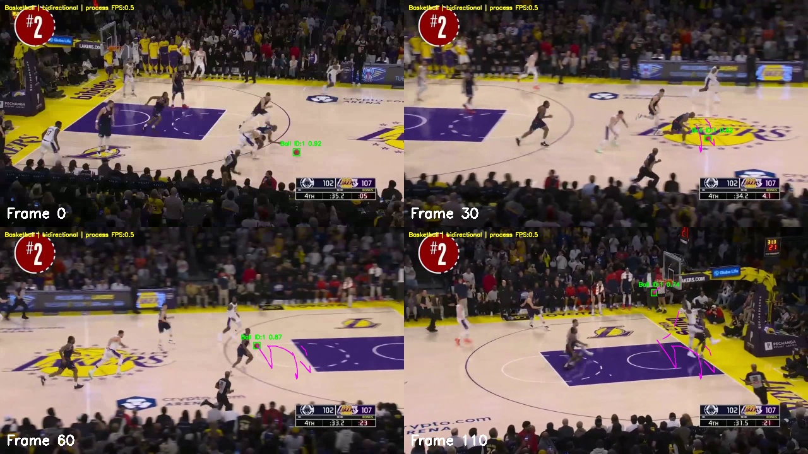

# YOLO + ByteTrack 篮球跟踪改进版（阶段性测试版）

**请先看 `开始使用.md`。当前不是“任意篮球视频都精准”的完成版。**

- 测试随包NBA原片：安装后双击 **`run_nba.cmd`**。
- 测试自己的视频：双击 **`篮球视频测试.cmd`**，选文件、视频类型，再框选首帧篮球并按 Enter。
- 无界面测试：`python run_nba.py --no-display`。



**实测情况：** 原NBA片段117帧中70帧有确认ID，均为ID=1；8个可见中心检查点命中7个，命中点平均误差1.13像素；9个已知人头/篮筐误跟检查点均未误跟。第106帧仍漏检，不能称为全程逐帧精准。

**其他视频：** 另一段NBA比赛的独立验证未通过（手动初始化后仍仅命中1/3个检查点）；近景训练短片有改善，但检查样本少。不要把原片调优结果或代码测试通过当作泛化保证。完整数据、失败记录和方法见 [实验报告](docs/NBA_RESULTS.md)。

新篮球模式使用公开预训练YOLO上的领域微调、多尺度局部搜索、人体关键点/光流排除人头、离线双向观察、时间一致性筛选和Ultralytics内置ByteTrack。训练标注与复现工具随包提供，运行无需重新训练。CPU可离线处理但比较慢，默认不保证实时。

新视频操作说明见 [篮球视频指南](docs/BASKETBALL_GUIDE.md)。原通用球体模式和原近景演示仍保留。

## 1. Windows 安装与第一次运行

在 Anaconda Prompt 中执行（先解压项目，切换到含 `main.py` 的目录）：

```bat
conda create -n balltrack python=3.12 -y
conda activate balltrack
python -m pip install torch==2.7.1 torchvision==0.22.1 --index-url https://download.pytorch.org/whl/cpu
python -m pip install -r requirements-dev.txt
python run_nba.py
```

使用 Python 3.11 时仅将建环境命令改为 `python=3.11`。先装 CPU 版 PyTorch，再装项目依赖，可避免默认安装不需要的 GPU 组件。首次安装需要网络；项目随附公开预训练权重和小型演示视频，不需要训练。项目目录建议放在较短路径，例如 `D:\Projects\ball-tracking-project`。命令必须在项目根目录执行。

窗口显示框、中心点、ID、置信度、轨迹与 FPS；按 **Q / ESC** 结束。每次使用新的 `--output` 目录，避免覆盖旧实验。视频按原始帧率写入；CPU 处理速度慢于原视频时，处理时间会延长，但输出视频仍按源帧率播放。

### 在 PyCharm 中运行

1. Open 打开项目根目录。
2. Settings → Project → Python Interpreter → Add Interpreter → Existing Conda Environment，选 `balltrack` 环境的 `python.exe`。
3. Run/Debug Configurations 新建 Python：Script path 选择 `main.py`，Working directory 选择项目根目录。
4. 推荐将 Script path 改选 `run_nba.py`，Parameters 留空，直接运行。
5. 如命令行能运行而 PyCharm 提示缺包，检查解释器是否选到了同一 Conda 环境。

## 2. 输入、保存与 GPU

本地 MP4（路径有空格时加双引号）：

```bat
python main.py --video "D:\Videos\basketball.mp4" --save --output runs/basketball
```

内置或 USB 摄像头：

```bat
python main.py --camera 0 --save --output runs/camera_test
```

摄像头序号可能为 1 或 2。Windows 使用 DirectShow 后端；在系统设置中允许桌面应用访问摄像头，并关闭占用摄像头的会议软件。**云端未验证本地摄像头，需在 Windows 实机完成验收。** 相机正常退出时写入视频尾部索引，因此录制后请按 Q 退出。

无窗口批处理：

```bat
python main.py --video data/demo/input.mp4 --no-display --save --output runs/batch
```

降低 CPU 负载（小球召回率可能下降）：

```bat
python main.py --video data/demo/input.mp4 --imgsz 320 --threads 2 --no-display --output runs/cpu320
```

GPU 为可选项：另建环境，按 https://pytorch.org/get-started/locally/ 为显卡和驱动安装匹配的 CUDA 版 PyTorch / torchvision。保持项目所用两者版本配套，验证 `python -c "import torch; print(torch.cuda.is_available())"` 返回 True，再运行：

```bat
python main.py --video data/demo/input.mp4 --device 0 --save --output runs/gpu
```

默认 `--device cpu`，不会要求有 GPU；指定 GPU 不可用时明确报错，不会悄悄更改实验设备。

## 3. 项目结构

```text
ball-tracking-project/
├── main.py                     启动入口
├── requirements.txt            运行依赖（固定主要版本）
├── requirements-dev.txt        加上 pytest 的测试依赖
├── yolov8s.pt                  推荐演示使用的公开预训练权重
├── yolo11n.pt                  可选轻量模型
├── balltrack/
│   ├── app.py                  输入、检测跟踪、绘图、保存、运行统计
│   ├── history.py              有界轨迹、丢失清理、遮挡断点
│   └── evaluate.py             带标注的评估与阶段 FPS
├── configs/bytetrack.yaml       跟踪阈值与遮挡缓存
├── tools/
│   ├── synthetic.py            双目标与遮挡的跟踪独立实验
│   └── make_demo.py            公开照片生成可重复演示视频
├── tests/test_system.py         自动化测试
├── data/demo/                  演示输入、逐帧真值、来源说明
├── docs/EXPERIMENTS.md          实验定义、实测结果和论文方法
├── evidence/                   本次云端测试与运行结果
└── .github/workflows/test.yml   Windows / Python 3.11、3.12 测试矩阵
```

开发先完成命令行最小流程，再添加轨迹与输出，最后补齐可重复实验和测试。业务逻辑集中在小模块中，适合后续增加界面、训练或更换检测模型。

## 4. 输出与参数

每次运行生成：

- `annotated.mp4`：仅使用 `--save` 时生成。
- `tracks.csv`：零基帧号、源视频时间（秒）、目标 ID、原图像素坐标 xyxy、置信度。ID=-1 表示未获得跟踪 ID。
- `frames.csv`：每帧推理耗时、处理耗时与当前有 ID 的目标数。
- `summary.json`：帧数、检测帧占比、唯一 ID 数、FPS、参数、库版本、权重 SHA256 与跟踪配置。

`python main.py --help` 查看全部参数。常用：`--conf 0.1`、`--imgsz 640`、`--trail 90`、`--max-frames 90`、`--threads 4`。`--conf` 应低于或等于 ByteTrack 的 `track_low_thresh` 才能完整保留低分二次匹配候选。默认 0.1；提高到 0.25 会削弱低置信度恢复能力。

`detection_frame_fraction` 只表示有输出框的帧占比，**不代表检测准确率**；`unique_track_ids` 也不代表真实球数。逐帧真值评估见下文。

## 5. 遮挡与轨迹规则

`model.track(..., persist=True, tracker=...)` 在同一视频内保留跟踪状态。ByteTrack 用高分检测建立关联，再用低分检测尝试匹配；Kalman 状态与 lost 缓存可在短暂漏检后恢复 ID。`track_buffer: 30` 为默认处理帧缓存；本固定版本的 Ultralytics 以 30 FPS 初始化跟踪器，缓存按调用帧计数，不能直接解释成任意视频的 1 秒。

轨迹只绘制真实输出的观察点；遮挡帧不伪造检测框，重现后不跨缺失帧画直线。轨迹长度有界，过期目标清理。相机移动、快速反弹、多个球交叉、长遮挡可能导致 ID 变化；ByteTrack 无外观重识别，不能保证恢复原 ID。可复制配置文件修改 buffer 后用 `--tracker configs/your_config.yaml` 对照实验。

## 6. sports ball 的能力与局限

COCO 类别 `sports ball`（标准类号 32，程序按类名查找）可覆盖常见篮球、足球、网球等体育球体，统一输出 `ball`，不细分球种。它不是通用“任何圆形物体”检测器：气球、轴承、弹珠、乒乓小球等不保证识别；球过小、运动模糊、严重遮挡、逆光、压缩损失或领域差异均可能导致漏检或误检。合成彩色圆不能替代真实球检测验证。

提高 imgsz、较大模型或调整拍摄距离可能提高召回率，但会降低 CPU FPS。先固定拍摄条件，用标注评估，再决定是否需要少量领域数据微调；本项目不从零训练。预训练模型也可能曾见过 COCO 演示图，因此演示仅作为功能回归，不能作为独立泛化成绩。

权重来源：https://github.com/ultralytics/assets/releases/download/v8.3.0/yolov8s.pt 及 https://github.com/ultralytics/assets/releases/download/v8.3.0/yolo11n.pt 。Ultralytics 代码与模型的使用遵循其 AGPL-3.0 / 商业许可说明：https://www.ultralytics.com/license 。演示图片的来源见 `data/demo/SOURCE.txt`；COCO 图像各自保留原始许可。项目原创代码许可见 LICENSE。

## 7. 测试视频与可重复实验

随包的 `data/demo/input.mp4` 是 COCO 真实体育照片经过轻微平移、插入 8 帧遮挡生成的 90 帧视频，有对应 `gt.json`。它用于验证真实 YOLO 权重、ByteTrack、视频读写、轨迹与评估链路；不是自然运动数据集。输入 30 FPS，480×640。

重新生成：下载并解压 https://github.com/ultralytics/assets/releases/download/v0.0.0/coco128.zip ，然后执行：

```bat
python -m tools.make_demo --coco128 "D:\Datasets\coco128" --output data/rebuilt_demo
```

完整演示评估：

```bat
python main.py --video data/demo/input.mp4 --no-display --save --output runs/experiment640
python -m balltrack.evaluate --gt data/demo/gt.json --tracks runs/experiment640/tracks.csv --timings runs/experiment640/frames.csv --output runs/experiment640/evaluation.json
```

独立跟踪验证（直接注入确定性检测框，**不运行 YOLO**）：

```bat
python -m tools.synthetic --buffer 30 --output runs/buffer30
python -m tools.synthetic --buffer 2 --output runs/buffer2
```

真实自录测试：固定相机、光照和帧率，依次拍摄单球、双球、短遮挡、快速运动，各 10–30 秒。避免同时改变多个变量。保存原视频并逐帧标注；`gt.json` 格式、指标公式、阶段划分、重复运行与对照表详见 `docs/EXPERIMENTS.md`。

## 8. 自动化测试及验收

```bat
python -m pytest -q
```

本次在云端 Linux 上实际执行 Python 3.11 / 3.12；详见 `evidence/` 与实验文档。Windows 的 CI 工作流已提供，但本次没有 Windows 实机执行记录，不把配置文件等同于通过记录。摄像头及显示窗口需本地手工检查：打开摄像头、显示多目标框与轨迹、按 Q 关闭、输出 MP4 可播放、换索引或断开设备能报错。

常见问题：

- 无检测框：先用随包演示测试；检查球的大小、清晰度；尝试 `--imgsz 960`。不要把普通圆形图案当作可靠正样本。
- 下载权重失败：随包已有 `yolo11n.pt`；也可手动从来源下载并用 `--model "D:\Models\yolo11n.pt"`。
- GUI 错误：本地安装 `opencv-python`，不要同时安装 `opencv-python-headless`；服务器加 `--no-display`。
- 视频打不开或零帧：检查路径、文件完整性，必要时先转为 H.264 编码的 MP4。
- MP4 无法写入：检查目录权限、磁盘空间和 OpenCV 编码器。正常结束程序后再播放。
- FPS 低：先试 `--imgsz 320`，调节线程数，或配置 GPU；本项目确保 CPU 功能可运行，不承诺所有 CPU 达到实时 30 FPS。
